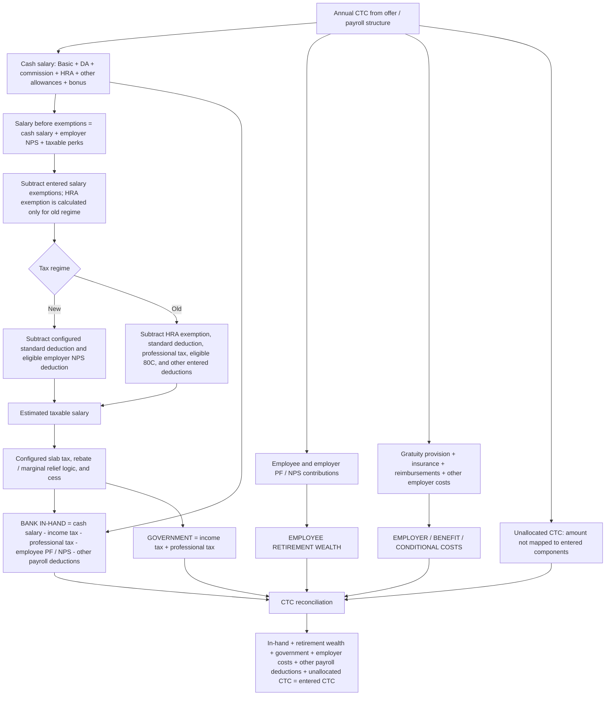

# Indian Salary and CTC Estimator

A small, dependency-free Python command-line estimator for comparing estimated
salary tax and monthly in-hand pay under the old and new tax regimes. It also
shows how the entered CTC is divided between cash in hand, retirement savings,
government payments, employer-side costs, and any unallocated amount.

> **Important:** This is an educational estimate, not tax, payroll, or legal
> advice and not an ITR preparation tool. Tax-year rates and limits in the
> program are assumptions carried forward from an earlier version and have not
> been verified for Tax Year 2026-27. Verify the applicable Finance Act, rules,
> notifications, and your employer's payroll treatment before relying on a
> result. The program does not cover every deduction, exemption, tax rate, or
> taxpayer situation.

## Files

- `indian_salary_ctc_estimator.py`: current estimator, with old/new regime
  comparison, CTC destination summary, and increment sweep.
- `index.html`, `styles.css`, and `app.js`: responsive static browser interface.
- `web_calculator.py`: JSON adapter that calls the same Python estimator used
  by the command-line program.
- `.github/workflows/pages.yml`: deploys the static site to GitHub Pages on
  pushes to `main` and on manual workflow dispatch.

## Run It

Requires Python 3.9 or later; there are no third-party packages.

```bash
python3 indian_salary_ctc_estimator.py
```

Enter annual amounts, not monthly amounts. At the end, the program asks whether
to run a 0%, 5%, 10%, 15%, 20%, and 25% CTC increment sweep. The sweep applies
the same percentage to the entered compensation and employer-contribution
heads; rent, professional tax, personal deductions, and exemption claims stay
fixed. An actual employer may change salary components, PF basis, or benefits
differently after an increment.

## Use It as a Webpage

The web page runs the Python calculation code in the browser using Pyodide
(Python compiled to WebAssembly). It is a static site: GitHub Pages does not
run a Python web server. The page downloads Pyodide and the two Python files at
runtime; an internet connection is required to load the first page, Python
runtime, and Google-hosted fonts.

### Preview locally

From the project directory, start Python's static file server:

```bash
python3 -m http.server 8000
```

Open <http://localhost:8000>. Do not open `index.html` directly as a `file://`
URL; the browser needs HTTP to fetch the Python modules and Pyodide runtime.

### Publish with GitHub Pages

1. Create an empty GitHub repository and add it as this project's `origin` if
  one is not configured:

  ```bash
  git remote add origin https://github.com/USERNAME/REPOSITORY.git
  ```

2. Commit and push the site files to the `main` branch. Do not add the ignored
  `interactive_salary_calculator.py` unless you intend to publish it.

  ```bash
  git add .gitignore .nojekyll README.md index.html styles.css app.js \
    indian_salary_ctc_estimator.py web_calculator.py .github/workflows/pages.yml
  git commit -m "Add browser salary estimator"
  git push -u origin main
  ```

3. In the GitHub repository, open **Settings → Pages** and set the build and
  deployment source to **GitHub Actions**. The workflow at
  `.github/workflows/pages.yml` will deploy on pushes to `main`.

4. Wait for the **Deploy static web app to GitHub Pages** workflow to finish.
  The site URL appears in the workflow deployment environment and under
  **Settings → Pages**. For a project repository it is usually
  `https://USERNAME.github.io/REPOSITORY/`.

The page's relative file requests support the project-site URL path. Calculations
are executed client-side in the visitor's browser; no salary inputs are sent to
a custom application server by this project. The browser does retrieve public
runtime assets and source files from the configured CDN and Pages site.

## Calculation Flow



### Calculation stages

1. **Map CTC to components.** The estimator does not infer a salary structure
   from total CTC. Cash salary and employer-side CTC amounts must be entered
   separately. `unallocated_ctc` is the leftover after the entered cash salary,
   employer PF/NPS, and employer costs are totaled. If components exceed CTC,
   the output warns that the structure is overallocated.
2. **Build salary before exemptions.** The code adds Basic, DA, commission, HRA,
   other cash allowances, and bonus. It then adds employer NPS and taxable
   non-cash perquisites. Do not enter the same amount in multiple fields.
3. **Apply salary exemptions.** Old-regime HRA exemption is computed from HRA,
   rent less 10% of qualifying salary, and the configured city percentage.
   Other old/new regime exemption fields are amounts the user must have
   confirmed with payroll; they are not derived from allowance names.
4. **Apply deductions.** The estimator subtracts the configured standard
   deduction. In the old regime it also subtracts professional tax, eligible
   employee PF plus other 80C (capped by the program), and other entered
   old-regime deductions. Eligible employer NPS deduction is subtracted only
   up to the amount entered as employer NPS. The program's tax-year limits and
   regime eligibility require verification.
5. **Estimate income tax.** Taxable salary is passed to the configured slab
   calculation, then the program applies its configured rebate/marginal-relief
   logic and 4% cess. These numeric rules are not guaranteed to be current for
   Tax Year 2026-27.
6. **Estimate in-hand and CTC destinations.** Income tax, professional tax,
   employee PF/NPS, and other payroll deductions reduce cash in hand. Employee
   and employer PF/NPS are shown as retirement wealth. The CTC reconciliation
   is an accounting view; it does not mean every amount is available as cash.

## Input Guide: What to Enter and Where to Find It

Use the annual column in the offer-letter salary annexure or annualized payroll
records. A monthly amount can be annualized as monthly amount × 12 only when it
is paid for all 12 months. A variable bonus should reflect the estimate you
want to model; it may not be guaranteed.

| Program prompt | Category in this estimator | Where to find it / how to decide |
| --- | --- | --- |
| Total annual CTC | Employer's total annual package | Offer letter, compensation annexure, or HR portal. This is not the same as gross salary or annual bank deposits. |
| Basic salary | Cash salary; normally taxable salary | Salary breakup in the offer, monthly payslip, or Form 16 Part B. |
| Dearness allowance (DA) | Cash salary; normally taxable salary | Offer or payslip. If DA is absent, enter 0. The DA flag only affects the estimator's HRA qualifying-salary calculation; confirm the applicable basis with payroll. |
| House rent allowance (HRA) | Cash salary; possible old-regime HRA exemption | Offer/payslip or Form 16 Part B. Enter the full annual HRA, not the exempt amount. The estimator does not claim HRA exemption in the new regime. |
| Other cash allowances | Cash salary; treated as taxable unless eligible exemption is entered separately | Sum the other cash allowance lines in the offer/payslip. Do not include Basic, DA, HRA, commission, or bonus again. An allowance's name alone does not make it tax-exempt. |
| Bonus / incentive | Cash salary; taxable salary assumption | Offer bonus terms, incentive plan, or payslip. Enter expected annual payout; actual payout and timing may differ. |
| Commission | Cash salary; taxable salary assumption | Commission plan or payslip. |
| HRA-qualifying commission | Subset of commission used only in the HRA formula | Enter only the commission amount that payroll confirms qualifies for the HRA salary base (for example, commission fixed as a percentage of turnover). It is already included in Commission; do not add it again to salary. |
| Taxable non-cash perquisites | Non-cash compensation included in salary for the estimate | Form 16 Part B, employer perquisite statement, or payroll. Enter only the taxable value and exclude employer NPS, which has its own fields. Avoid duplicating amounts already included in cash salary. |
| Employee PF | Employee payroll deduction; retirement savings; may count toward old-regime 80C | Payslip, payroll declaration, or EPFO passbook. It reduces in-hand pay. The estimator adds it to 80C in the old regime, subject to the program's cap; it is not deducted from taxable salary in the new regime. |
| Employee NPS | Employee payroll deduction; retirement savings | Payslip or NPS statement. It reduces in-hand pay. The estimator does not automatically calculate all possible employee NPS deductions; any eligible old-regime amount must be included in the applicable deduction input without double-counting. |
| Employer PF | Employer contribution; retirement wealth; usually part of CTC | Offer/CTC breakup, payslip, or EPFO passbook. It is not an employee payroll deduction. Do not enter it as a taxable perquisite unless payroll identifies an amount as taxable. The estimator does not calculate PF contribution limits or taxable excess automatically. |
| Employer NPS and eligible employer NPS deduction | Employer contribution is retirement wealth; eligible deduction reduces taxable salary | Employer NPS statement, payslip, or payroll tax worksheet/Form 16 Part B. Enter the full employer contribution once, then enter only the deduction amount payroll confirms is eligible. The estimator caps the deduction at the contribution entered. |
| Gratuity provision | Employer-side / conditional CTC cost, not monthly cash | Offer annexure or HR's CTC explanation. If the offer says gratuity may be paid to eligible employees but gives no annual CTC amount, ask HR whether a provision is included; do not invent one. A provision in CTC is not the same as gratuity actually paid. |
| Insurance / benefits cost | Employer-side benefit cost if included in CTC | HR benefits statement or CTC breakup. The offer may describe coverage without assigning a CTC cost. Enter a cost only if HR provides it and confirms it is included in CTC. |
| Reimbursements | Employer-paid expense amount; tax treatment depends on purpose, records, and rules | Expense policy, claims portal, and payroll. Enter only an amount included in CTC and treated by payroll as an official-duty reimbursement. A label such as fuel, telephone, or books does not by itself establish exemption. |
| Other employer costs | Other non-cash or conditional employer-side package items | Detailed CTC breakup and HR confirmation. Use this only for amounts not already entered in another employer-cost field. |
| Annual rent paid | Personal fact used for old-regime HRA calculation | Rent agreement, rent receipts, bank transfers, and payroll declarations. Enter actual annual rent, not HRA. |
| HRA metro city | HRA calculation selector | Answer yes only for a rented home in Delhi, Mumbai, Kolkata, or Chennai under this estimator's configured rule. Otherwise answer no. |
| Other old/new regime exemptions | Salary exemption amounts | Payroll tax worksheet, Form 16 Part B, or a specific employer confirmation. Enter the eligible amount for that regime, excluding HRA. Do not enter the allowance's full amount unless it is all confirmed exempt. |
| Other 80C | Old-regime deduction | Proofs/submissions and payroll tax worksheet. Enter eligible 80C amounts other than employee PF. Keep within the applicable combined limit; the estimator applies its configured cap to this field plus employee PF. |
| Other old-regime deductions | Other old-regime deduction total | Payroll worksheet or tax records after checking eligibility and limits. Exclude amounts already entered as 80C or employer NPS. The program does not validate each section or its limit. |
| Professional tax | Payroll deduction and government payment | Payslip or payroll tax worksheet; it varies by work location and applicable rules. Enter the amount actually deducted/expected. The estimator subtracts it from in-hand in both regimes and from taxable salary only in the old-regime path. |
| Other payroll deductions | Employee-side reduction in cash pay | Payslip, such as a recurring employee deduction not already entered as PF, NPS, professional tax, or income tax. Do not put TDS here; estimated income tax is already subtracted. |
| Resident status and age group | Personal tax facts affecting configured rebate/slabs | Residence depends on tax-law tests, not citizenship alone. Age group is used for the estimator's old-regime slab selection. Consult official guidance if unsure. |

### Documents worth checking

- **Offer letter / compensation annexure:** annual Basic, HRA, allowances,
  LTA, bonus terms, employer PF/NPS, gratuity, benefits, and total CTC.
- **Monthly payslips:** actual salary paid, employee PF/NPS, professional tax,
  TDS, reimbursements, and other payroll deductions.
- **Form 16 Part B:** employer-reported salary, exemptions, deductions, taxable
  perquisites, and tax computation for the completed financial/tax year.
- **Form 16 Part A / tax-credit records:** TDS deposited by the employer. TDS
  is a tax prepayment/credit, not an additional tax cost on top of final tax.
- **EPFO passbook / PF statement:** employee and employer PF credits. Confirm
  whether the offer's contribution amount matches payroll.
- **Rent agreement, receipts, and payment records:** support actual rent and
  employer HRA declarations. The estimator only approximates HRA eligibility.
- **Investment, insurance, and loan documents:** evidence for deductions you
  choose to enter; eligibility and limits still need checking for the tax year.
- **Employer benefits and expense policies:** confirm whether insurance or
  reimbursements are part of CTC, their value, and their payroll tax treatment.

An offer letter gives a proposed structure, not necessarily final taxable pay.
Use actual payslips and Form 16 when available, and ask HR/payroll about any
unclear CTC line. Employers use different package structures; CTC labels are
not a substitute for the applicable tax rules.

## What Goes in Which Bucket?

| Bucket | Examples | Effect in this estimator |
| --- | --- | --- |
| Cash salary | Basic, DA, HRA, cash allowances, bonus, commission | Adds to cash salary. Tax exemptions are applied separately and only when entered/eligible. |
| Taxable perquisites | Employer-reported taxable non-cash benefits | Adds to salary for estimated tax; is not added to bank cash. Check payroll values to avoid double counting. |
| Employee deductions | Employee PF/NPS, professional tax, other payroll deductions | Reduce estimated in-hand. Some may also reduce taxable income under a particular regime; cash-flow treatment and tax deduction are separate. |
| Employer retirement contributions | Employer PF/NPS | Count as retirement wealth, not bank in-hand. Employer NPS can also have a separate eligible tax deduction. Applicable limits/taxable excess are not fully assessed by this tool. |
| Employer / conditional costs | Gratuity provision, insurance cost, employer-paid expenses, other CTC benefits | Reduce the portion of CTC available as cash, but are not automatically salary exemptions or tax deductions. |
| Government | Estimated income tax plus professional tax | Income tax is estimated liability, not necessarily the same as monthly TDS. Professional tax is shown separately from income tax in the calculation. |
| Unallocated CTC | CTC not explained by entered components | Helps identify missing or unknown items in the offer breakup. Ask HR to explain a material remainder. |

**Do not classify an amount from its name alone.** For example, LTA, conveyance,
telephone, fuel, and meal-related lines may have specific conditions or limits;
the estimator does not automatically determine whether a claim qualifies.

## Example: Reading a CTC Annexure

The following is a fictional example created only to illustrate the categories:
Basic ₹5,00,000, HRA ₹2,00,000, other cash allowance ₹1,00,000, and employer
PF ₹60,000.

- Cash salary entered as Basic + HRA + other cash allowance = **₹8,00,000**.
- Employer PF entered separately as **₹60,000**.
- Total CTC reconciles to **₹8,60,000**.
- Employee PF, rent, professional tax, and exemption eligibility are not
  implied by these example amounts; enter those separately when known.

## Increment Sweep Assumptions

The increment sweep is a scenario, not a compensation forecast. It multiplies
CTC, salary components, PF/NPS contributions, and employer-cost fields by the
same factor. Rent, professional tax, personal deductions, and entered
exemptions remain unchanged. Actual increases may change Basic/HRA ratios, PF
bases or caps, bonus eligibility, benefits, and withholding. Review a new
salary structure with HR before treating a sweep row as a payslip estimate.

## Scope and Limitations

- Numeric slabs, rebate thresholds, standard deductions, 80C cap, cess, and
  related behavior are hard-coded assumptions in `indian_salary_ctc_estimator.py`.
  Confirm each for the applicable tax year before use.
- Rebate eligibility, marginal relief, surcharge and surcharge marginal relief,
  tax rounding, special-rate income (including capital gains), foreign income,
  loss adjustments, tax credits/TDS settlement, and many ITR-specific rules are
  not fully modeled.
- The estimator does not determine residential status, whether a deduction is
  legally available, whether an allowance qualifies for exemption, PF taxable
  perquisite thresholds, or employer compliance. It relies on user-entered
  values and limited checks.
- No ITR form selection, filing, e-verification, or refund/balance-due
  reconciliation is performed.
- Results may not match employer payroll due to monthly rounding, contribution
  bases, caps, timing, declaration proofs, or employer-specific policies.

Before using this for a real tax decision, compare the inputs and tax-year rules
with the current official Income Tax Department/CBDT guidance and your employer's
Form 16/payroll computation. Consult a qualified tax professional for
individualized advice.

## Basic Validation

Check syntax with Python:

```bash
python3 -m py_compile indian_salary_ctc_estimator.py
```

The repository does not yet include a formal automated test suite.